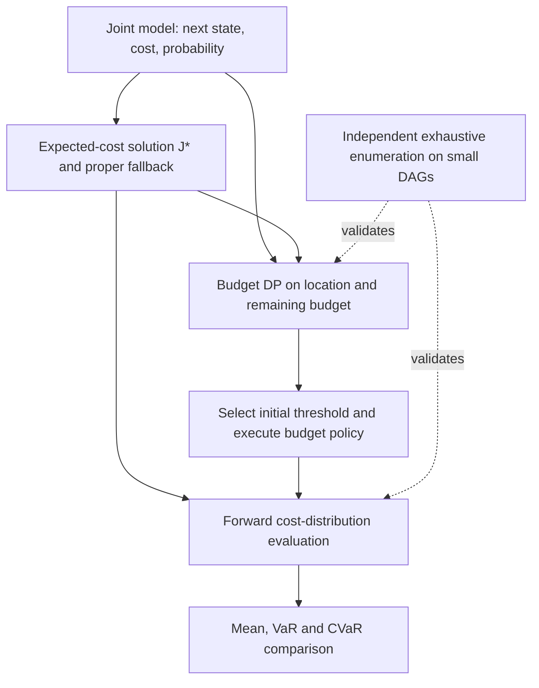

# A 的展示材料

以下是可供组内整合的内容源稿；本次未制作整张 poster、slides 或录像，也未加入尚未完成的网格优化结果。

## Poster：形式化文字

**Model.** A finite SSP with joint outcomes \(P(s',c\mid s,a)\), positive integer costs, and an absorbing goal. We minimize undiscounted total travel time: \(Z=\sum_{t<T}C_t\), \(\gamma=1\).

**Mean objective.** \(\min_\pi E_\pi[Z]\) uses conditional mean stage costs while retaining stochastic transitions.

**Tail objective.** \(\min_\pi\mathrm{CVaR}_{\alpha}(Z)=\min_y\{y+W(s_0,y)/(1-\alpha)\}\), where \(W(s,b)\) is the minimum expected excess cost with remaining budget \(b\).

If the poster needs the risk definition independently of the solver notation, use: \(\mathrm{CVaR}_\alpha(Z)=\min_y\{y+E[(Z-y)^+]/(1-\alpha)\}\). At α=0.9 this averages exactly the worst 10% of travel times. Model assumptions: a proper policy exists from every state; improper stationary policies incur infinite expected cost from some state. Positive stage costs support the latter condition.

## Poster：方法说明

Expected-cost dynamic programming supplies the mean-optimal value and a proper fallback policy. Budget dynamic programming minimizes expected excess cost in the augmented state (location, remaining budget). Forward propagation then evaluates each policy's total-cost distribution. Small acyclic examples are checked by exhaustive history-dependent policy enumeration before interpreting larger experiments.

## 方法框图源稿

## Poster：已核对数字

| 例子 | 选择 | 均值（分钟） | CVaR₀.₉（分钟） |
|---|---|---:|---:|
| 桥与绕行 | 桥 | 10.9 | 100 |
| 桥与绕行 | 绕行 | 12 | 12 |
| 相同均值 | A | 11 | 20 |
| 相同均值 | B | 11 | 11 |
| 偶尔特别快 | C | 10 | 11 |
| 偶尔特别快 | 固定 B | 11 | 11 |

推荐图注：A 1.1-minute expected-time advantage can hide an 88-minute increase in worst-decile mean travel time.

这个差值比较的是两条路线各自最坏十分位的均值，不是说每次走桥都多花 88 分钟。图中不能把 CVaR 与最大值混为一谈。

## 理论讲解顺序

1. 用桥与绕行解释均值与尾部的目标差异。
2. 定义 γ=1 的 SSP，说明 proper 条件替代直接照搬折扣压缩论证。
3. 用全期望解释为什么风险中性目标可以使用均值单步代价。
4. 用例子 1 的 7(90%)、21(9%)、50(1%) 分布算出 23.9。
5. 固定 y=7，说明到 M 后剩余预算分别为 6 和 −13，为什么分别选 Y 和 X。
6. 用独立穷举、参考 DP 和模拟解释“我们怎样知道答案对”。明确这是 A 的本地验证，不能代称 C 的实现。

## 常见问答

**为什么不只用 Dijkstra？**

随机转移使一条动作序列不再对应确定路径；CVaR 也不是可直接逐边相加的普通边权。转移确定、目标为期望时，可以用均值边权运行 Dijkstra 作为核对。

**预算是不是现实中的最大允许耗时？**

这里是 CVaR 变分式中的辅助阈值。允许超支；超支后继续付费并到达终点。机会约束是另一个目标。

**为什么已经堵了还走有风险的 X？**

例子 1 中，慢的首段已经占最坏 10%。X 后续期望为 3.9，比固定 6 小，因此降低这部分的平均总耗时。它可能增加最大可能耗时，CVaR 并非最坏单一结果。

**为什么不选“每一步 CVaR 最小”的动作？**

每步重新优化条件 CVaR，相当于改变了起点承诺的静态目标；例子 1 中它会在 M 始终选 Y，得到 26，而非 23.9。

**我们提出了新算法吗？**

没有把已有增广状态思想当原创。课程项目侧重整数 SSP 的实现、独立验证和策略差异的可解释量化。

**分布精确是否意味着没有误差？**

完整有限支撑时，没有截断或格点投影误差，浮点程序仍有舍入。A 的精确枚举使用分数；有环网格若截断则还需要尾部界。

**例子 2 为什么还保留例子 1 的 X/Y？**

为了保留可手算的风险决策，同时新增不同目的状态、相关的转移与代价、三个不同的已花时间。它是有针对性的回归验证，不是全面基准。
